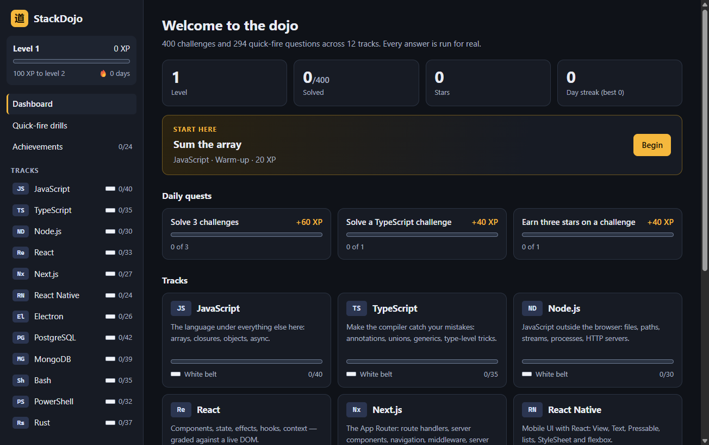

# StackDojo

**A gamified desktop practice app for a full modern stack — where every answer is actually run.**

400 hands-on coding challenges and 294 quick-fire questions across twelve technologies, with XP, belts, streaks and achievements to keep you coming back. Write real code in the built-in editor; StackDojo compiles it, runs it, or queries a real database with it, and shows you exactly what passed and what failed.



## Contents

- [What you can practise](#what-you-can-practise)
- [Features](#features)
- [Getting started](#getting-started)
- [How grading works](#how-grading-works)
- [The game](#the-game)
- [Project structure](#project-structure)
- [Development](#development)
- [Adding challenges](#adding-challenges)
- [Accessibility](#accessibility)
- [Security model](#security-model)
- [Limitations](#limitations)
- [License](#license)

## What you can practise

| Track | Challenges | Drill questions | Topics |
|---|---:|---:|---|
| JavaScript | 40 | 26 | Arrays, closures, classes, promises, debounce and throttle |
| TypeScript | 35 | 24 | Annotations, unions, generics, mapped and conditional types |
| Node.js | 30 | 24 | Files, paths, streams, child processes, HTTP servers |
| React | 33 | 25 | State, effects, custom hooks, context, accessible components |
| Next.js | 27 | 24 | Route handlers, server components, middleware, server actions |
| React Native | 24 | 24 | View and Text, StyleSheet, flexbox, lists, modals |
| Electron | 26 | 24 | Windows, IPC, preload bridges, security hardening |
| PostgreSQL | 42 | 25 | Joins, grouping, window functions, CTEs, DDL and DML |
| MongoDB | 39 | 24 | Query operators, updates, the aggregation pipeline |
| Bash | 35 | 25 | Functions, quoting, exit codes, grep, sed and awk pipelines |
| PowerShell | 32 | 24 | The object pipeline, parameters, CSV and JSON, error handling |
| Rust | 37 | 25 | Ownership, borrowing, enums, traits, iterators, threads |
| **Total** | **400** | **294** | |

Each track is split into three tiers — **Warm-up**, **Core** and **Advanced** — and includes "fix the bug" exercises and a boss challenge.

## Features

- **Real execution, not pattern matching.** Your code runs against hidden tests in the real toolchain for that language. A Rust challenge shows you the real compiler error; a SQL challenge shows you the rows your query returned.
- **Nothing to install for the databases.** PostgreSQL runs in-process through [PGlite](https://pglite.dev) (Postgres compiled to WebAssembly) and MongoDB queries run on [mingo](https://github.com/kofrasa/mingo). Each attempt gets a fresh copy of the sample data.
- **Built to make you think.** Hints are tiered and cost XP. The reference solution stays locked until you have made three real attempts.
- **Quick-fire drills.** Ten-question rounds of predict-the-output and spot-the-trap questions, with a combo bonus. Questions you have not answered correctly yet come first.
- **Progress that persists.** XP, stars, streaks and your unfinished code are saved automatically.
- **Keyboard-first and accessible.** `Ctrl+Enter` runs your code from anywhere; the interface targets WCAG 2.1 AA.

## Getting started

### Requirements

| Requirement | Needed for |
|---|---|
| [Node.js](https://nodejs.org) 20 or newer | Installing and building the app |
| [Git for Windows](https://git-scm.com/download/win) (provides Git Bash) | The Bash track |
| Windows PowerShell 5.1, or `pwsh` on macOS and Linux | The PowerShell track |
| [Rust](https://rustup.rs) (`rustc`) | The Rust track |

Only Node.js is required to start. A track whose toolchain is missing says so in the app instead of failing; the other nine tracks work without any of the optional tools.

StackDojo is developed and tested on Windows 11. macOS and Linux should work but are untested.

### Install on Windows

Download `StackDojo-Setup-<version>.exe` from the [latest release](https://github.com/ForrestLasiter/stackdojo/releases/latest) and run it. The installer is not code-signed, so Windows SmartScreen will warn you the first time: choose **More info → Run anyway**. The installed app does not need Node.js.

### Run from source

```bash
git clone https://github.com/ForrestLasiter/stackdojo.git
cd stackdojo
npm install
npm start
```

On Windows you can also double-click `StackDojo.cmd` after cloning; it installs and builds on first run.

When a second monitor is connected, the window opens there.

## How grading works

Every submission goes through one code path, [`engine/grade.cjs`](engine/grade.cjs), which is also what the test suite uses.

| Track | What actually runs |
|---|---|
| JavaScript, Node.js | Your code in Node, against hidden tests |
| TypeScript | The TypeScript compiler in `strict` mode with type-level assertions, then the compiled code |
| React, Next.js | Compiled with esbuild, mounted in a DOM (jsdom) and driven with Testing Library — clicked and typed into like a user would |
| React Native | The same, rendered through react-native-web |
| Electron | A stand-in `electron` module in which `ipcRenderer` is wired to `ipcMain`, so a call through a preload bridge really reaches the main-process handler |
| PostgreSQL | PGlite. Your result set is compared with the reference solution's, including row order where the task asks for it |
| MongoDB | mongosh-style code against an in-memory database, compared the same way |
| Bash | Git Bash (or system Bash), in a throwaway directory |
| PowerShell | `powershell.exe` or `pwsh` |
| Rust | `rustc --test` |

Each run happens in a separate child process with a timeout, in a temporary directory that is deleted afterwards.

## The game

| Mechanic | How it works |
|---|---|
| XP | Warm-up 20, Core 40, Advanced 80. A clean first-try solve earns a 25% bonus |
| Stars | Three for a first-try solve with no hints; fewer as hints and retries add up |
| Hints | Each one reduces the XP for that challenge by 20% |
| Solutions | Locked until three attempts. Revealing one before solving caps the challenge at 25% XP |
| Belts | White through black, per track, by the share of challenges solved |
| Daily quests | Three per day, with bonus XP |
| Streak | Consecutive days with at least one solve or completed drill round |
| Achievements | 24 to unlock |

All scoring rules live in one file: [`src/game.ts`](src/game.ts).

## Project structure

```
electron/   Main process (window, save file, IPC) and the preload bridge
engine/     The grader: grade.cjs dispatches, harness.cjs runs the Node-based
            tracks, shims/ holds the electron and next stand-ins
content/    The curriculum (one file per track) and the sample databases
src/        The React interface
scripts/    Verification, end-to-end smoke test, contrast check
```

Built with Electron, React, TypeScript, Vite and CodeMirror 6.

## Development

```bash
npm test            # verify every challenge (see below)
npm run smoke       # launch the real app and drive it end to end
npm run typecheck   # TypeScript check of the interface
npm run contrast    # WCAG 2.1 AA colour-contrast check
npm run build       # build the interface into dist/
npm run dist        # build the Windows installer into release/
```

**`npm test`** runs every challenge through the real grader twice: the reference solution must pass, and the unmodified starter code must fail. That guarantees no challenge is unsolvable and none can be passed without doing the work. Pass track ids to check only some of them: `npm test rust bash`. A full run takes about five minutes.

**`npm run smoke`** opens the app against a throwaway profile, solves challenges through the editor, runs a SQL query, plays a drill round and confirms progress was saved, writing screenshots to `smoke-out/`. The window opens on a secondary monitor without taking focus, and the run is skipped if only one display is connected.

**`npm run dist`** produces `release/StackDojo-Setup-<version>.exe` with electron-builder: a per-user NSIS installer (no administrator rights needed) that adds Start menu and desktop shortcuts and an uninstaller. The installed app needs no Node.js; Git Bash and Rust are still required for those two tracks.

Drill questions are checked for structure only (a valid answer, no duplicate choices); their answers are not executed.

## Adding challenges

Add an entry to the track's file in [`content/tracks/`](content/tracks):

```js
{
  id: 'clamp', title: 'Clamp a number', tier: 1,
  prompt: "Write `clamp(n, min, max)` that returns `n` limited to the range.",
  starter: `function clamp(n, min, max) {\n  \n}\n`,
  solution: `function clamp(n, min, max) {\n  return Math.min(Math.max(n, min), max);\n}\n`,
  tests: `test('below', () => eq(clamp(-3, 0, 10), 0));`,
  hints: ['`Math.max(n, min)` lifts a value that is too low.'],
}
```

The comment at the top of each track file documents that track's test helpers. Then run `npm test <track>`.

Things to know:

- **Challenge ids are permanent.** Saved progress is keyed on `track/challenge`, so renaming an id resets it for anyone who solved it.
- **Code fields are JavaScript template literals.** Write `\${` and `\\n` inside them.
- **SQL and MongoDB have no hand-written expected output.** The grader runs your `solution` and compares against it, so the solution must be right.

## Accessibility

The interface targets WCAG 2.1 AA: semantic landmarks and headings, full keyboard operation, visible focus indicators, live-region announcements for results, state conveyed by text and icons rather than colour alone, and support for reduced motion. Colour contrast is checked by `npm run contrast`. It has not yet been tested with a screen reader.

The code editor captures the Tab key for indentation; press `Esc` and then `Tab` to move focus out of it.

## Security model

StackDojo runs code you write, on your own machine, with your own permissions — the same as running it in a terminal. It is a practice tool, not a sandbox for untrusted code.

The application itself follows Electron's security guidance: the renderer is sandboxed with context isolation and no Node integration, reaches the main process only through four named IPC calls, runs under a Content Security Policy, and cannot navigate away or open new windows.

## Limitations

- **Next.js and Electron** exercises run against stand-ins that keep the real APIs' contracts. No Next.js server or real window is started.
- **React Native** runs on the web renderer, so `Platform.OS` reports `"web"` and native-only modules are unavailable.
- **MongoDB** uses an in-memory implementation of the query language, not a MongoDB server; indexes are recorded but do not affect performance.
- **Speed:** most tracks grade in under a second; Rust and the React-based tracks take two to three seconds per run.
- The Windows installer is not code-signed, so Windows SmartScreen shows a warning the first time it runs (choose **More info → Run anyway**).

## License

[MIT](LICENSE) © Forrest Lasiter
